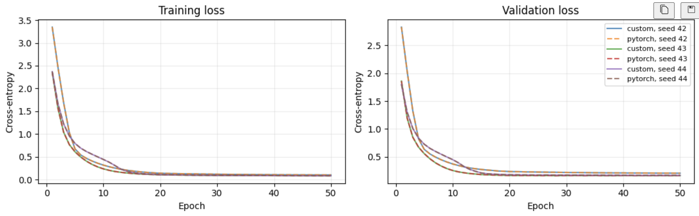
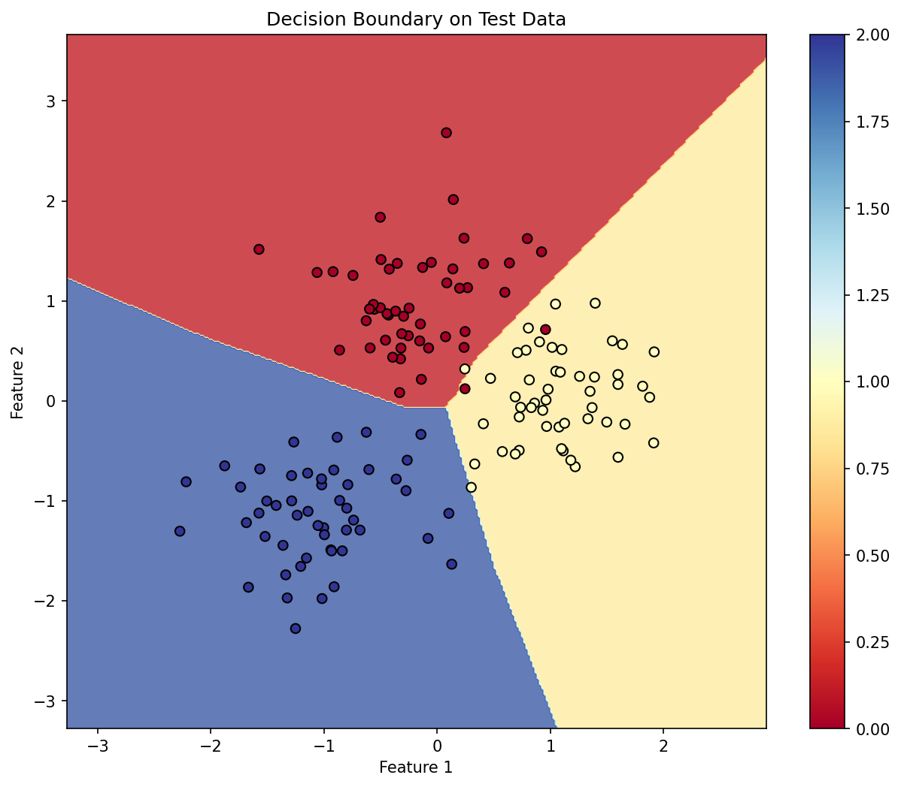

# Mini Autograd Engine

A scalar reverse-mode automatic differentiation engine and neural-network training pipeline built in Python, inspired by [Andrej Karpathy’s micrograd](https://github.com/karpathy/micrograd). Each graph node stores one number; backpropagation computes gradients through the recorded operations.

**98% test accuracy across three training seeds. Zero test-prediction disagreements with a matched float64 PyTorch MLP.**

## Results

On one fixed `make_blobs` dataset and split, both implementations achieved:

- **Test accuracy:** 98.00% ± 0.00 percentage points (147/150 correct in each run).
- **Test macro-F1:** 0.979997 ± 0.000001.
- **Test cross-entropy:** 0.06605 ± 0.00630.
- **Maximum validation-loss difference:** 1.33 × 10⁻¹⁵ across all 50 epochs and three seeds.
- **Maximum final test-logit difference:** 1.07 × 10⁻¹⁴; no paired prediction disagreements.

Mean ± sample standard deviation over training seeds **42, 43, 44**, with one dataset and stratified split fixed at seed 42. Seeds vary initialization and shuffling. Zero accuracy variation across these runs does not imply zero generalization uncertainty.



**Protocol:** 1,000 samples, two features, three classes; 700/150/150 train/validation/test split. Standardization is fitted on training data only. A **2 → 8 → 6 → 3 MLP (99 parameters)** uses ReLU hidden layers, linear output logits, He initialization, mean cross-entropy, Adam (`lr=0.001`), batches of 16, gradient clipping at norm 1, and learning-rate halving after epochs 20 and 40. Both implementations start from explicitly copied weights and use identical batch orders. Evaluation uses final-epoch weights.

[Raw runs, histories, configuration, and environment](results/benchmark_blobs/summary.json) are committed. Over 50 epochs using 700 training samples and 150 validation samples evaluated after each epoch, the custom scalar MLP took 25.07 ± 0.61 seconds, compared with 0.66 ± 0.13 seconds for the matched float64 PyTorch MLP on CPU. Values are mean ± sample standard deviation across three training seeds on macOS arm64.



*Decision boundary from the separate seed-42 demo in main.py. Background colors show predicted classes; point colors show true labels.*

## What is implemented

- Dynamic scalar computation graphs, iterative topological backpropagation, shared-operand gradient accumulation, and repeated backward calls that accumulate leaf gradients.
- Arithmetic, powers, exp/log, ReLU, tanh, and sigmoid; configurable MLP layers with He/Xavier initialization.
- SGD with momentum, Adam, mini-batch gradient averaging, clipping, learning-rate scheduling, and classification metrics.

The custom engine and MLP compute their own gradients and updates; PyTorch serves as the reference.

## Correctness checks

[`experiments/gradient_check.py`](experiments/gradient_check.py) copies a **2 → 3 → 2 tanh MLP** into float64 PyTorch and checks one input/target pair. Observed maximum absolute errors:

- Forward logits and cross-entropy: **0.0**.
- All **17 parameter gradients:** **1.11 × 10⁻¹⁶**.
- All parameters after one SGD update: **8.67 × 10⁻¹⁹**.
- All parameters after one Adam update: **1.73 × 10⁻¹⁸**.

The script asserts errors below `1e-10`. The [35 unit tests](tests/) also cover scalar operations, shared and branched graphs, accumulation, domain errors, extreme sigmoid inputs, cached multiplication values, and a **10,000-operation chain**. Both benchmark implementations use the project’s classification metric functions.

## Quick start

From the repository root:

```bash
python3 -m venv .venv
source .venv/bin/activate
python3 -m pip install -r requirements.txt
```

The recorded benchmark used Python 3.12.0; package versions are saved in the [environment metadata](results/benchmark_blobs/summary.json). Dependencies are not pinned, so newer environments can produce different numerical details or timings.

```python
from autograd.engine import Value

x = Value(2.0)
y = Value(3.0)
z = x * y + x
z.backward()

print(z.data)          # 8.0
print(x.grad, y.grad)  # 4.0 2.0
```

## Reproduce

```bash
python3 -m unittest discover -s tests -v
python3 -m experiments.gradient_check
python3 -m experiments.benchmark_blobs
python3 main.py
jupyter notebook autograd_notebook.ipynb
```

- The benchmark saves per-seed JSON files and `summary.json` in [`results/benchmark_blobs/`](results/benchmark_blobs/).
- The interactive demo saves metrics and figures in [`results/blobs_seed42/`](results/blobs_seed42/).
- The [short notebook](autograd_notebook.ipynb) develops differentiation intuition, renders a computation graph, demonstrates the API, and reads saved benchmark results. Graph rendering requires the **Graphviz system executable (`dot`)** in addition to the Python package: `brew install graphviz` on macOS or `sudo apt install graphviz` on Ubuntu/Debian.

## Attribution and license

Inspired by [micrograd](https://github.com/karpathy/micrograd) and [Karpathy’s tutorial](https://www.youtube.com/watch?v=VMj-3S1tku0).

[MIT License](LICENSE)
